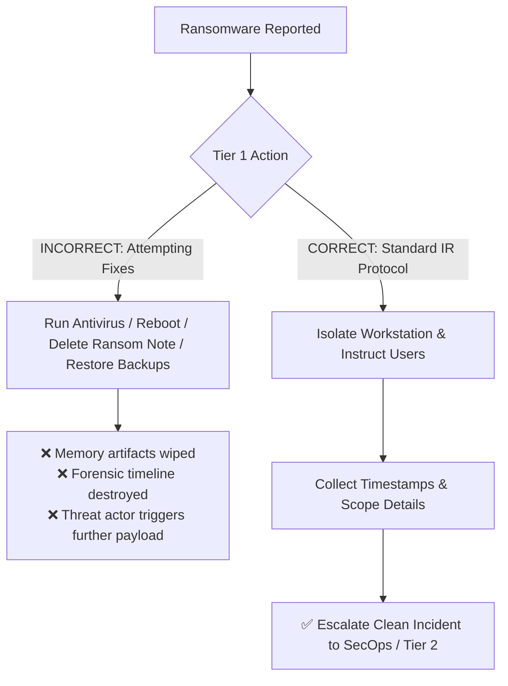
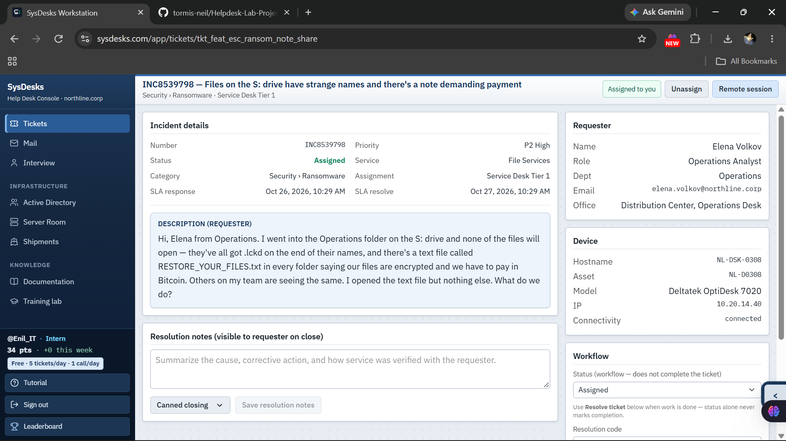
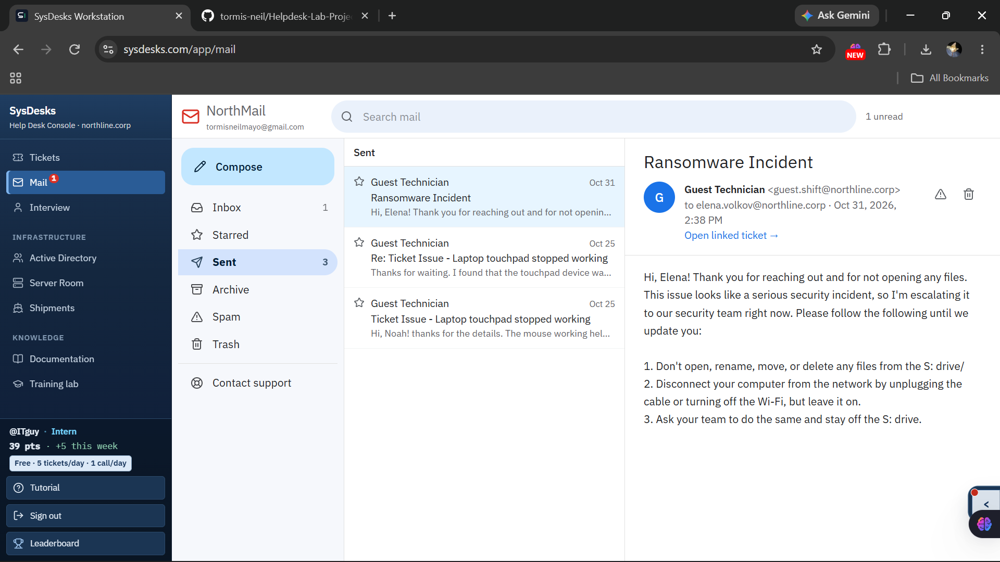
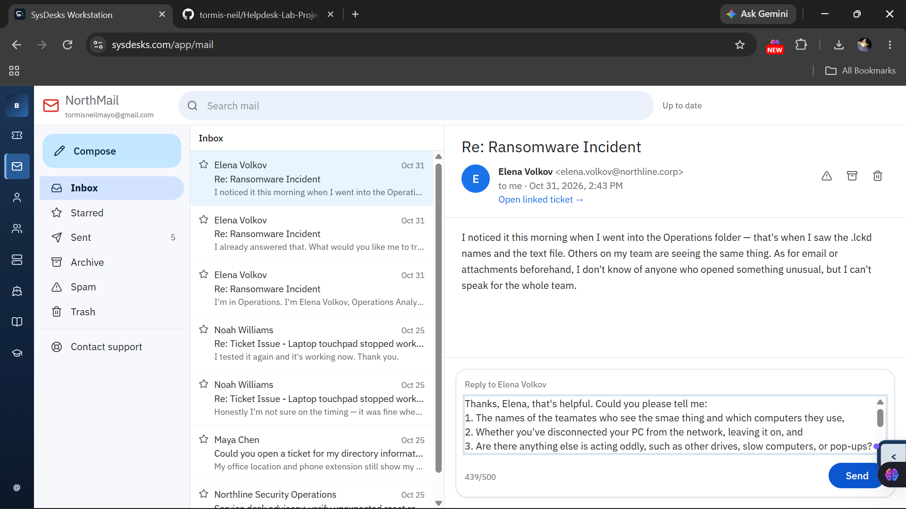
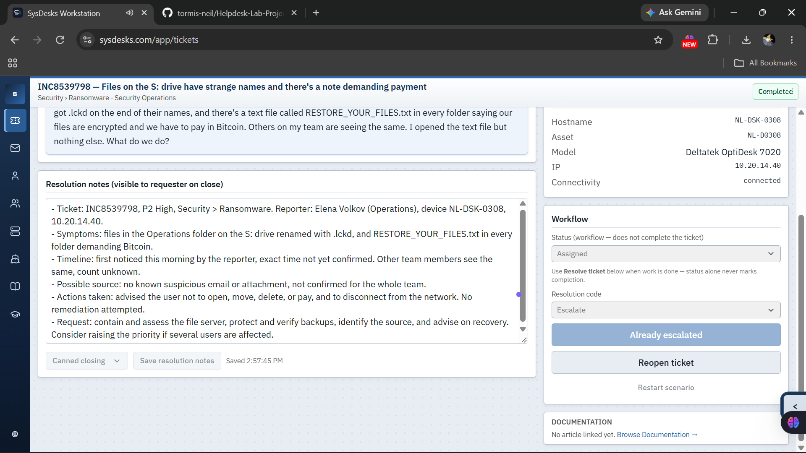
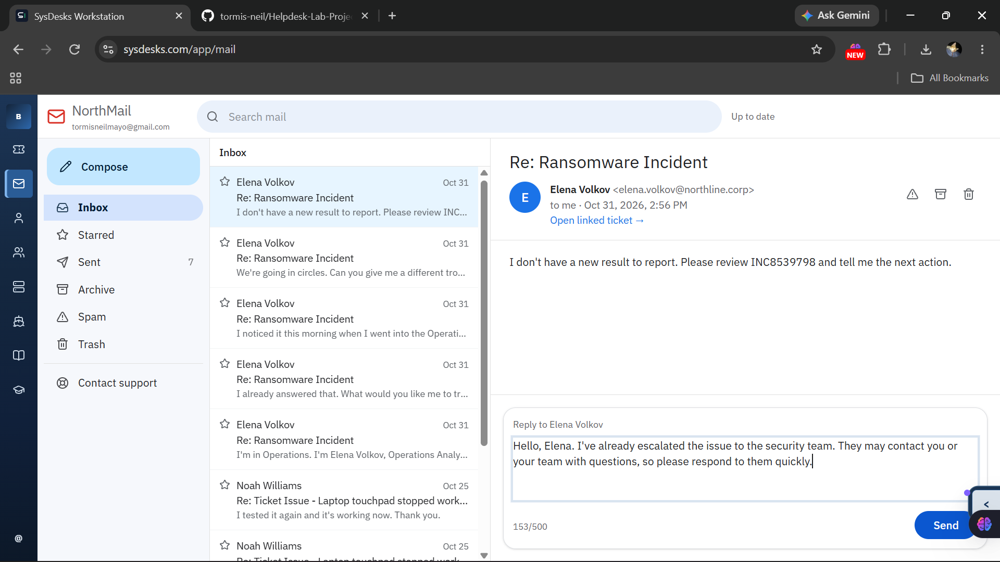

# Ticket 001: Suspected Ransomware on a Shared Drive (Incident Response & Escalation)

-2ea44f?style=for-the-badge)


---

## 📌 Executive Summary

This case study documents the handling of a suspected **ransomware infection** affecting an enterprise network share (`S:\ drive`) in the **SysDesk** enterprise simulation platform. 

As a **Tier 1 Service Desk Technician**, handling a suspected ransomware event requires rapid containment, strict adherence to cybersecurity incident handling protocols, empathy and de-escalation for panicked end-users, and structured technical handoffs to the **Security Operations (SecOps)** team. Attempting ad-hoc fixes at Tier 1 can destroy critical digital evidence or trigger further encryption. This incident highlights the balance between fast containment and disciplined evidence preservation.

---

## 📋 Ticket Metadata

| Field | Value |
| :--- | :--- |
| **Ticket ID** | `INC8539798` |
| **Category** | `Security > Ransomware` |
| **Service Affected** | `File Services` (Network Shared Drive `S:\`) |
| **Priority** | `P2 High` |
| **SLA Target** | Response: 4 hrs \| Resolution / Escalation: 24 hrs |
| **Tier** | Service Desk Tier 1 |
| **Requester** | **Elena Volkov**, Operations Analyst |
| **Department / Office** | Operations / Distribution Center, Operations Desk |
| **Requester Device** | Hostname: `NL-DSK-0308` \| Asset: `NL-D0308` \| Model: Deltatek OptiDesk 7020 |
| **Network IP** | `10.20.14.40` |
| **Tools Used** | SysDesk Incident Management Console, NorthMail Webmail |
| **Final Resolution** | **Contained & Escalated** (Resolution Code: `Escalate` to Security Operations) |

---

## 🚨 Incident Overview & User Report

### Initial Problem Description
> *"Hi, Elena from Operations. I went into the Operations folder on the S: drive and none of the files will open — they've all got .lckd on the end of their names, and there's a text file called RESTORE_YOUR_FILES.txt in every folder saying our files are encrypted and we have to pay in Bitcoin. Others on my team are seeing the same. I opened the text file but nothing else. What do we do?"*

### Why This Was Immediately Treated as a Critical Security Incident
1. **Classic Indicators of Compromise (IoCs):** Mass file renaming with an unfamiliar extension (`.lckd`) and persistent ransom note text files (`RESTORE_YOUR_FILES.txt`) demanding cryptocurrency ransom.
2. **Blast Radius & Multi-User Impact:** The issue was not isolated to a single local workstation; it was actively affecting a central network shared resource (`S:\` drive) relied upon by multiple staff in the Operations department.
3. **High Risk of Active Spread:** Ransomware worms and malware binaries often traverse mapped network shares, write permissions, and SMB protocols to encrypt adjacent directories and servers.

---

## 🛡️ Tier 1 Security Philosophy: Containment > Remediation

A crucial competency for any IT Support technician is knowing **what NOT to do** during an active security breach:



### Why I Refrained from Attempting Local Remediation:
- **Preserving Volatile RAM & Forensic Evidence:** Rebooting, restarting services, or running ad-hoc malware cleanup tools flushes memory registers and temporary storage where encryption keys, command-and-control (C2) artifacts, and execution scripts reside.
- **Preventing Additional Encryption:** Interacting with files or allowing users to test further could trigger secondary payloads or accelerate encryption threads across mapped shares.
- **Protecting Backup Integrity:** Backups must be checked and isolated by Tier 2 / SysAdmins / Security before any recovery attempt to prevent infected files from overwriting clean restore points.
- **Strict Role Boundary:** Tier 1's mission is **triage, stop the bleeding, gather facts, and escalate**. Tier 2 / SecOps handles root cause analysis, malware eradication, and disaster recovery.

---

## 🔄 Step-by-Step Incident Lifecycle

### Phase 1: Ticket Intake & Initial Assessment
Upon reviewing the incoming ticket in SysDesk, I validated the priority (`P2 High`), affected asset (`NL-DSK-0308`), and scope. Because network file shares were impacted, immediate action was required to prevent propagation.



---

### Phase 2: Immediate Containment Protocol (First Response)
I responded immediately via NorthMail to Elena with strict, plain-language containment instructions before asking non-critical questions.



#### Direct Communication Sent:
> **Subject:** Ransomware Incident  
> *"Hi, Elena! Thank you for reaching out and for not opening any files. This issue looks like a serious security incident, so I'm escalating it to our security team right now. Please follow the following until we update you:*
> 1. *Don't open, rename, move, or delete any files from the S: drive.*
> 2. *Disconnect your computer from the network by unplugging the cable or turning off the Wi-Fi, but leave it on.*
> 3. *Ask your team to do the same and stay off the S: drive."*

**Key Decision Rationale:**
- **"Leave it on":** Powering off destroys volatile RAM data needed by the forensics team.
- **"Disconnect from network":** Cuts off lateral movement across the internal subnet (`10.20.14.0/24`).
- **"Don't touch/rename/delete":** Prevents file system metadata alteration.

---

### Phase 3: Information Gathering & Scoping
Elena confirmed she noticed the issue in the morning and that other colleagues observed the same symptom, though she was unaware of any suspicious phishing emails.



#### Follow-up Triage Questions:
I probed for missing critical details without burdening the user with deep technical jargon:
1. Names and hostnames of teammates observing the symptoms.
2. Confirmation that network isolation (cable unplugged / Wi-Fi off) was successfully executed.
3. Any other anomalous system behavior (unusual slowdowns, pop-ups, other drive issues).

---

### Phase 4: Soft Skills, User Empathy & De-escalation
When dealing with security incidents, end-users often feel high anxiety or frustration due to halted productivity. Elena replied:
> *"We're going in circles. Can you give me a different troubleshooting step?"*


#### How I De-escalated the Situation:
- **Validated Her Frustration:** Acknowledged the stress and inconvenience of the delay without becoming defensive.
- **Clear, Honest Explanation:** Explained *why* we were intentionally pausing troubleshooting—because attempting fixes could destroy data recovery chances.
- **Gave a Firm, Safe Action Item:** Re-emphasized keeping off the shared drive to protect her files.
- **Set Realistic Expectations:** Assured her that the ticket was actively being championed with the specialized security team.

---

### Phase 5: Structured Security Escalation & Handover Notes
In the SysDesk ticket console, I set the resolution code to **`Escalate`**, documented comprehensive handover notes, and routed the incident to **Security Operations**.



#### Exact Handover Notes Documented:
```markdown
- Ticket: INC8539798, P2 High, Security > Ransomware. Reporter: Elena Volkov (Operations), device NL-DSK-0308, 10.20.14.40.
- Symptoms: files in the Operations folder on the S: drive renamed with .lckd, and RESTORE_YOUR_FILES.txt in every folder demanding Bitcoin.
- Timeline: first noticed this morning by the reporter, exact time not yet confirmed. Other team members see the same, count unknown.
- Possible source: no known suspicious email or attachment, not confirmed for the whole team.
- Actions taken: advised the user not to open, move, delete, or pay, and to disconnect from the network. No remediation attempted.
- Request: contain and assess the file server, protect and verify backups, identify the source, and advise on recovery. Consider raising the priority if several users are affected.
```

---

### Phase 6: User Follow-up & Closing the Loop
After escalating the ticket, I promptly replied to the user to maintain the communication loop and advise her on what to expect next.



#### Final User Communication:
> *"Hello, Elena. I've already escalated the issue to the security team. They may contact you or your team with questions, so please respond to them quickly."*

---

## 🎯 Key Competencies Demonstrated

### 1. Technical Knowledge & Security Awareness
- **Ransomware Recognition:** Identified file extension alteration (`.lckd`) and ransom text notes as high-confidence ransomware indicators.
- **Incident Containment:** Executed standard isolation protocols (physical disconnect / Wi-Fi toggle while preserving system power).
- **Evidence Integrity:** Protected memory artifacts and drive logs by stopping all manual modifications.

### 2. ITIL / ITSM Incident Management
- **P2 Incident Classification:** Categorized impact on multi-user operational file storage appropriately.
- **SLA & Escalation Protocol:** Adhered strictly to Tier 1 service boundaries, routing to Security Operations within established timeframes.
- **Standardized Handoff Documentation:** Drafted structured notes detailing *Symptoms, Timeline, Source, Actions Taken,* and *Next Action Requests*.

### 3. Customer Service & Soft Skills
- **Plain-Language Communication:** Avoided alienating jargon when instructing the requester.
- **De-escalation under Pressure:** Managed an anxious user seeking quick workarounds by providing reassurance, empathy, and clear safety rationales.
- **Ownership & Expectation Management:** Kept the requester informed of status and handoff expectations.

---

## 💡 Lessons Learned & Key Takeaways

1. **Containment First, Details Second:** In a ransomware scenario, seconds count. The very first response must instruct users to isolate and cease activity before gathering exhaustive survey answers.
2. **The "Hero Trap" Destroys Evidence:** Trying to be the hero at Tier 1 by running cleaners or restarting machines often turns a recoverable incident into an unrecoverable disaster. Knowing your limits is a sign of technical maturity.
3. **Communication Prevents Panic:** Frustrated users often test things repeatedly if left in the dark. Clear, transparent explanations about *why* we must wait prevent users from making the situation worse.
4. **Structured Escalation Saves SecOps Hours:** Providing structured notes (who, what, where, IP, MAC/Asset, actions taken, actions avoided) allows Security Operations to immediately begin threat hunting rather than re-interviewing the user.
