# Ticket 002: Managed Tablet Joined to Guest Wi-Fi, Company App Offline

-2ea44f?style=for-the-badge)


---

## 📌 Executive Summary

This case study documents the troubleshooting and resolution of a mobile enterprise device issue in the **SysDesk** simulation environment. A warehouse supervisor reported that an **Orchard SlatePad (10th Gen)** tablet had Wi-Fi and could access external websites in Safari, but the mission-critical **Inventory Scan** enterprise application was unable to reach internal corporate services.

As a **Tier 1 Service Desk Technician**, solving this issue required an understanding of **enterprise network segmentation (Guest vs. Corporate)**, **Mobile Device Management (MDM)**, **802.1X certificate-based authentication**, and patient, clear end-user communication. The issue was resolved permanently without modifying or resetting MDM profiles, enabling the warehouse team to complete their time-sensitive receiving count.

---

## 📋 Ticket Metadata

| Field | Value |
| :--- | :--- |
| **Ticket ID** | `INC6272241` |
| **Category** | `Mobile Devices > SlatePad Wi-Fi` |
| **Service Affected** | `Warehouse Mobility` |
| **Priority** | `P3 Moderate` |
| **SLA Target** | Response: Oct 29, 2026, 10:07 AM \| Resolve: Oct 30, 2026, 10:07 AM |
| **Tier** | Service Desk Tier 1 |
| **Requester** | **Devon Park**, Warehouse Supervisor |
| **Department / Office** | Operations / Distribution Center, Operations Desk |
| **Requester Device** | Hostname: `NL-TAB-0221` \| Asset: `NL-IP0221` \| Model: Orchard SlatePad (10th gen) |
| **Initial Network IP** | `172.18.44.27` (Connectivity: `limited`) |
| **Resolved Network IP** | `10.30.22.41` (Connectivity: `connected`) |
| **Tools Used** | SysDesk Incident Console, Remote Support Console (Touch-enabled SlatePad), NorthMail |
| **Final Resolution** | **Solved (Permanently)** — Switched from `Northline-Guest` to `Northline-Corp` |

---

## 🔍 Incident Overview & Initial Clues

### User Problem Description
> *"Hi, this is Devon Park from Operations. The warehouse SlatePad shows Wi-Fi, and Safari can open public pages, but Inventory Scan says it cannot reach the company service. I need it for today’s receiving count. Could you check which network it joined and help me get the managed app online without removing company management?"*

### Diagnostic Clues & Analysis

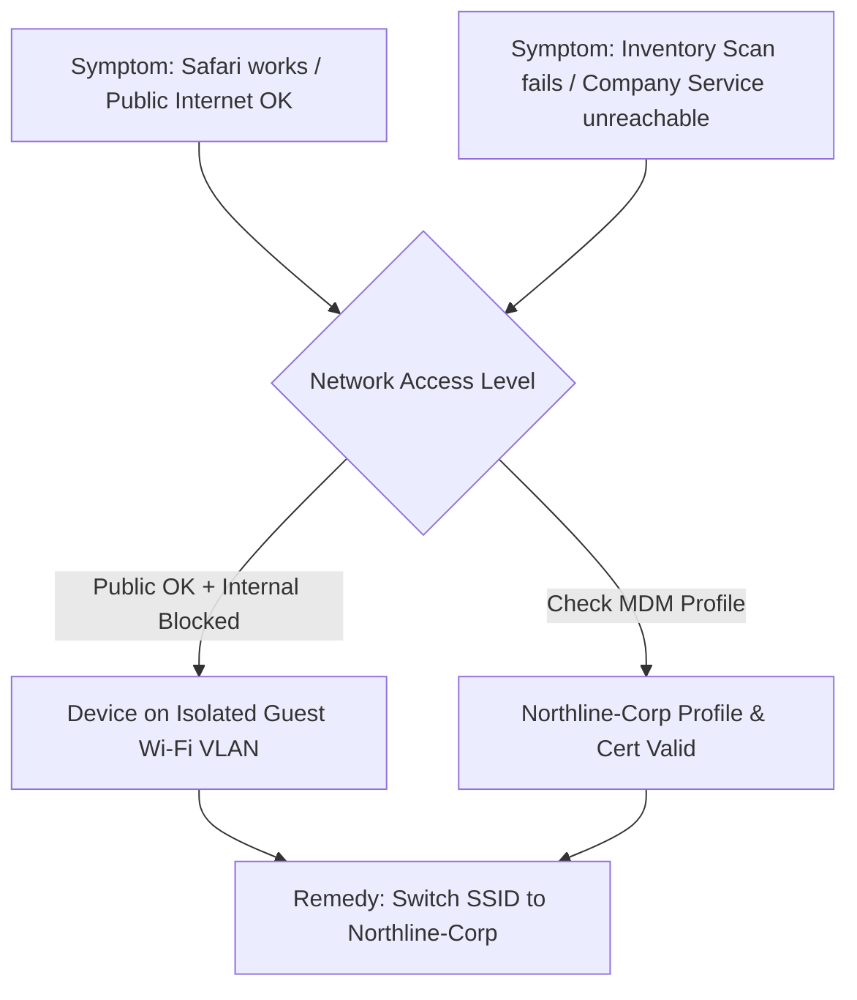

1. **Public Web Browsing Works, Internal App Fails:** This is a classic symptom of network isolation. The tablet possessed internet connectivity, but lacked private routing to internal endpoints (`inventory.northline.corp:443`).
2. **Device is MDM-Managed:** The requester specifically asked not to remove management. Technicians must resist the urge to factory reset or delete MDM profiles when simpler network-level fixes exist.
3. **Console IP Clue (`172.18.44.27` / `limited` connectivity):** In enterprise environments, corporate subnets are typically segregated from guest subnets. The `172.18.x.x` address and `limited` flag suggested a guest or DMZ subnet.
4. **User Perception vs. System Evidence:** The user mentioned their taskbar icon indicated "not connected to any network," highlighting the need to verify facts directly rather than guessing.

### Differential Diagnosis (Hypotheses Evaluated)

| Hypothesis | Initial Likelihood | Investigation Result | Status |
| :--- | :---: | :--- | :---: |
| **1. Tablet joined to Guest / Non-Corp Wi-Fi** | **High** | Remote inspection showed connection to `Northline-Guest`. | **CONFIRMED** |
| **2. MDM Wi-Fi Profile / Certificate Expired** | **Medium** | Checked MDM: Profile installed, cert valid to Jul 30, 2027. | **RULED OUT** |
| **3. Device Non-Compliant / Supervised Lockout** | **Low** | Device compliance verified as "Compliant". | **RULED OUT** |
| **4. DNS or Backend Service Outage** | **Low** | Backend was healthy; unreachable only due to guest routing. | **RULED OUT** |

---

## 🛠️ Step-by-Step Resolution Lifecycle

### Phase 1: Ticket Intake & Initial Assessment
Reviewed the ticket metadata, noting the asset `NL-IP0221` and IP address `172.18.44.27`. Established that the warehouse receiving count was time-sensitive, requiring rapid triage without disruptive configuration resets.

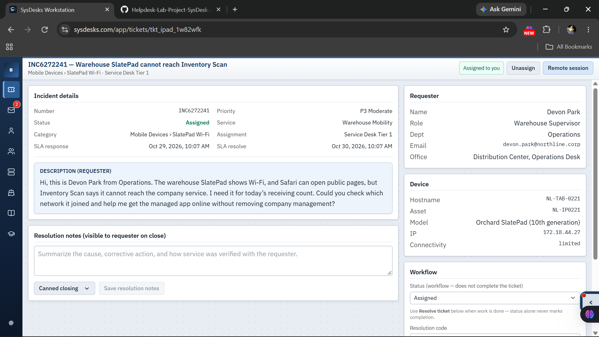

---

### Phase 2: Protective Instructions & Initial User Triage
Sent an immediate response to Devon Park via NorthMail. Guided the user to avoid deleting MDM profiles or factory resetting the tablet, while asking targeted questions.

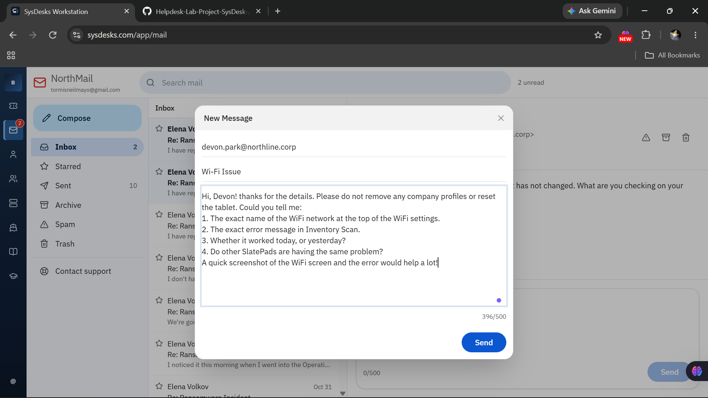

#### Communication Sent:
> *"Hi, Devon! Thanks for the details. Please do not remove any company profiles or reset the tablet. Could you tell me:
> 1. The exact name of the WiFi network at the top of the WiFi settings.
> 2. The exact error message in Inventory Scan.
> 3. Whether it worked today, or yesterday?
> 4. Are other SlatePads having the same problem?
> A quick screenshot of the WiFi screen and the error would help a lot!"*

---

### Phase 3: Structured One-Step-at-a-Time Communication
When Devon replied that the icon showed "not connected" and felt overwhelmed, I adapted my approach to reduce friction by taking things one step at a time and validating his urgency.

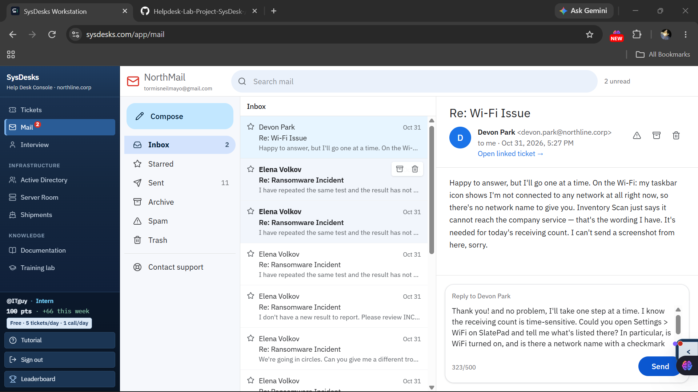

---

### Phase 4: Remote Support Consent
Rather than relying on user guesswork, I requested permission to establish a remote support session to inspect the device settings directly while keeping the user informed.

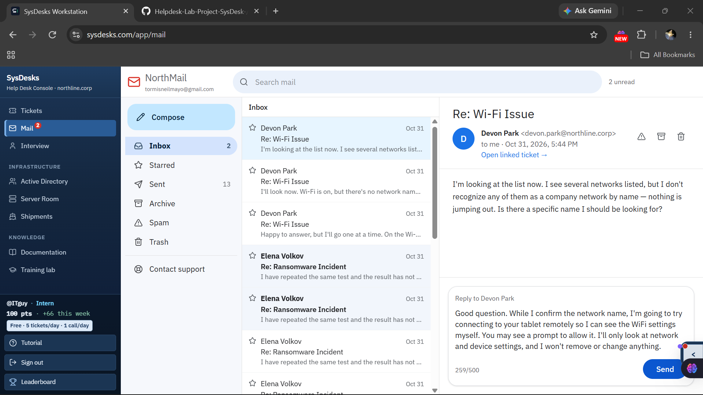

#### Communication Sent:
> *"Good question. While I confirm the network name, I'm going to try connecting to your tablet remotely so I can see the WiFi settings myself. You may see a prompt to allow it. I'll only look at network and device settings, and I won't remove or change anything."*

---

### Phase 5: MDM Compliance & Certificate Verification
Upon entering the remote session, before altering any network settings, I checked **Settings > VPN & Device Management** to ensure the enterprise profile was intact:
- **Device Compliance:** `Compliant` (Supervised, Non-removable)
- **Identity Certificate:** Valid through `Jul 30, 2027`
- **Managed Payloads:** `Northline-Corp Wi-Fi` installed, `Inventory Scan` required

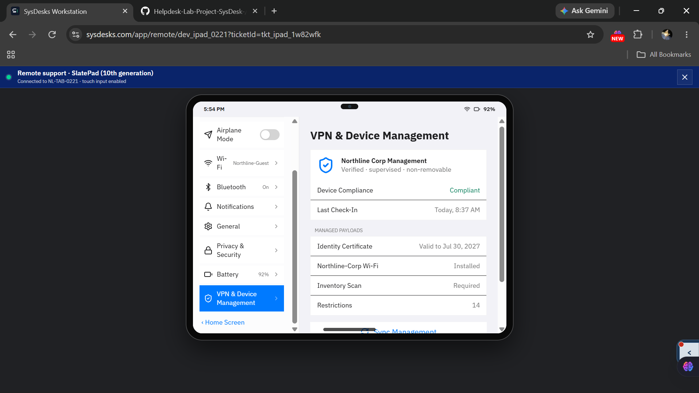

---

### Phase 6: Identifying Root Cause in Wi-Fi Settings
Navigating to **Settings > Wi-Fi** revealed the root cause:
- **Active Connection:** `Northline-Guest` (Open • public internet) with a blue checkmark.
- **Available Managed Network:** `Northline-Corp` (Managed • identity certificate) was available but unjoined.

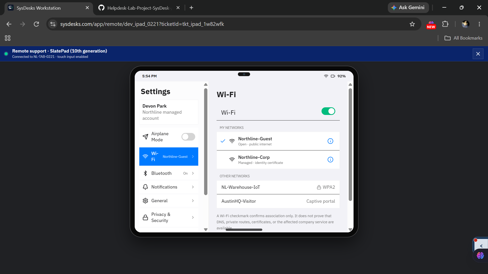

---

### Phase 7: Joining Corporate 802.1X Network
Selected **`Northline-Corp`**. The system prompted to authenticate using the installed managed device identity certificate—requiring no manual password entry. Connected successfully.

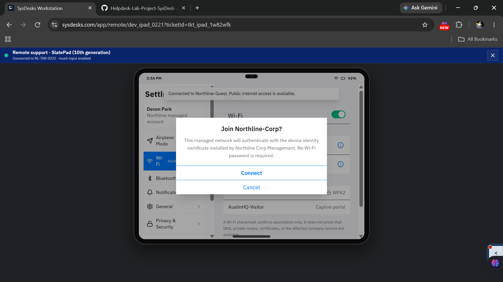

---

### Phase 8: Multi-Layer Technical Verification
Switched to the **Inventory Scan** application to verify service health:
- **Service Status:** `Service online` (Warehouse catalog synchronized. Scanner ready.)
- **Endpoint:** `inventory.northline.corp:443`
- **Active Wi-Fi:** `Northline-Corp`
- **Internal IP Address:** Updated from guest `172.18.44.27` to corporate subnet `10.30.22.41`.

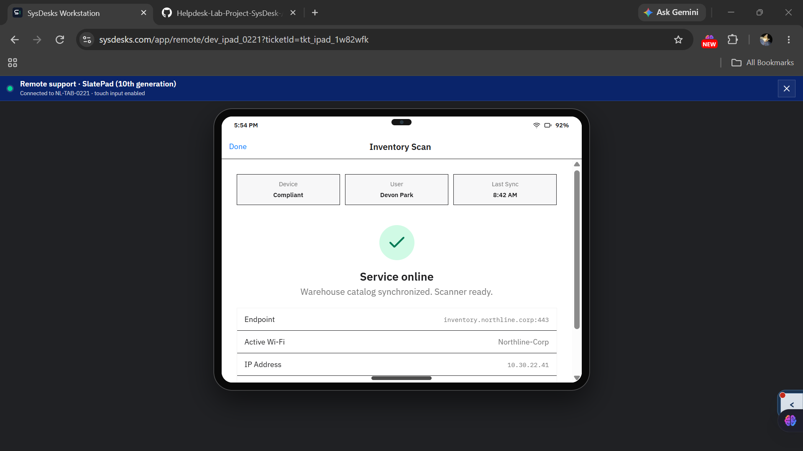

---

### Phase 9: End-User Validation & Proactive Advice
Informed Devon that the tablet was rejoined to the corporate network and asked him to test the receiving count. Devon confirmed the receiving list was loading properly and asked what to do if it ever dropped off after a restart. I provided clear, proactive instructions.

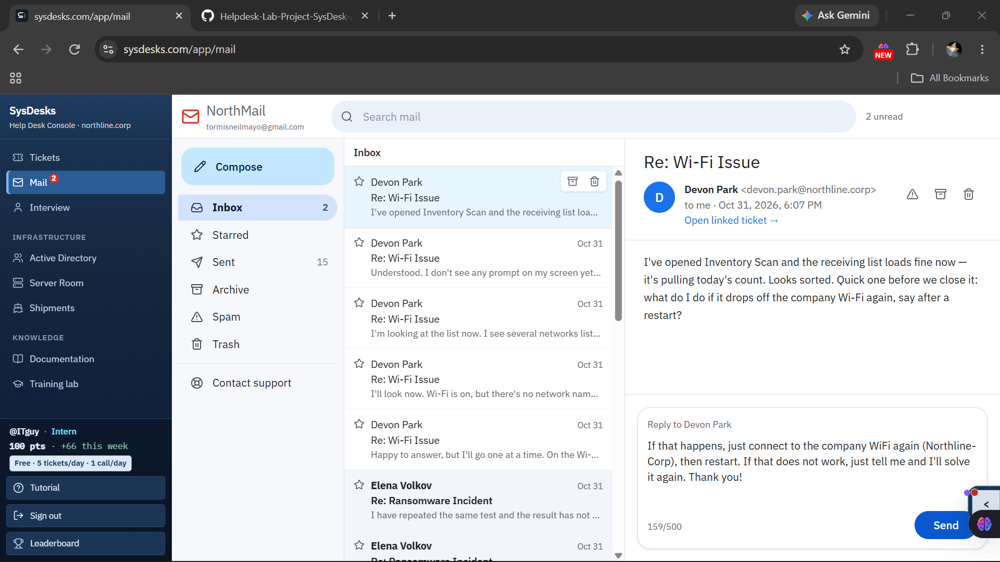

#### Communication Sent:
> *"If that happens, just connect to the company WiFi again (Northline-Corp), then restart. If that does not work, just tell me and I'll solve it again. Thank you!"*

---

### Phase 10: Ticket Documentation & Formal Closure
Updated the ticket resolution notes in the SysDesk console with a structured summary, set the resolution code to **`Solved (Permanently)`**, and closed the incident.

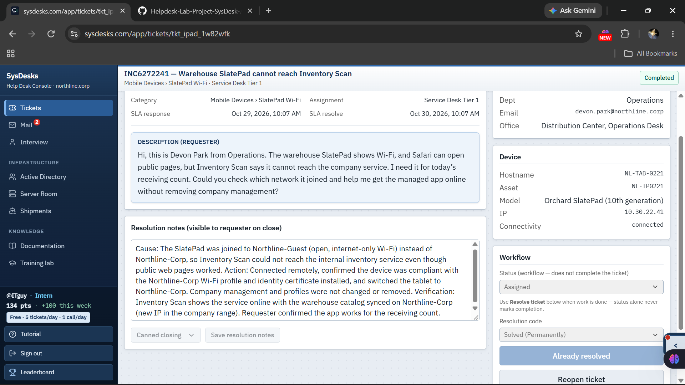

#### Exact Closure Notes Documented:
```markdown
Cause: The SlatePad was joined to Northline-Guest (open, internet-only Wi-Fi) instead of Northline-Corp, so Inventory Scan could not reach the internal inventory service even though public web pages worked. 

Action: Connected remotely, confirmed the device was compliant with the Northline-Corp Wi-Fi profile and identity certificate installed, and switched the tablet to Northline-Corp. Company management and profiles were not changed or removed. 

Verification: Inventory Scan shows the service online with the warehouse catalog synced on Northline-Corp (new IP in the company range). Requester confirmed the app works for the receiving count.
```

---

## 🎯 Key Competencies Demonstrated

### 1. Enterprise Networking & Mobile Support
- **VLAN & Network Segmentation:** Understood the functional boundary between open guest Wi-Fi and corporate internal network segments.
- **802.1X EAP-TLS Authentication:** Verified managed identity certificates for seamless enterprise network authentication without sharing pre-shared keys (PSK).
- **Subnet Analysis:** Recognized `172.18.x.x` vs `10.30.x.x` subnet transitions as proof of correct routing.

### 2. MDM & Configuration Management
- **Rule Out Before Modifying:** Verified MDM compliance and profile expiration dates prior to taking action, avoiding destructive re-enrollments or wipes.
- **Preserved Management Integrity:** Resolved the issue entirely within device settings without disturbing corporate supervision policies.

### 3. Customer Service & Remote Assistance
- **Non-Intrusive Remote Sessions:** Clearly communicated remote session boundaries, establishing trust with the user.
- **Pacing & Empathy:** Kept instructions to one question at a time when the user felt overwhelmed by technical requests.
- **Proactive User Enablement:** Addressed what-if scenarios (e.g., after-reboot behavior) before closing the ticket.

---

## 💡 Lessons Learned & Technician Reflections

1. **"Connected to Wi-Fi" ≠ "Connected to Corporate Services":** An active Wi-Fi icon or checkmark only confirms radio association to an access point; it does not guarantee DNS resolution or routing to internal corporate servers.
2. **Never Assume — Verify with Direct Evidence:** The user reported being disconnected from all networks, but remote tools and console logs revealed an active connection to the wrong SSID. Always verify facts objectively.
3. **Don't Fix What Isn't Broken:** When an app fails, junior technicians often suspect MDM corruption or reinstall apps. Checking network settings first saves time and prevents configuration drift.
4. **Proactive Documentation Closes Tickets Cleaner:** Explaining the cause clearly to the user prevents repeat tickets and empowers staff to self-resolve minor network disconnections.
