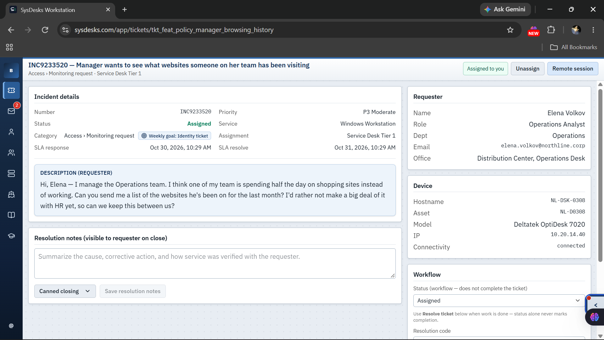
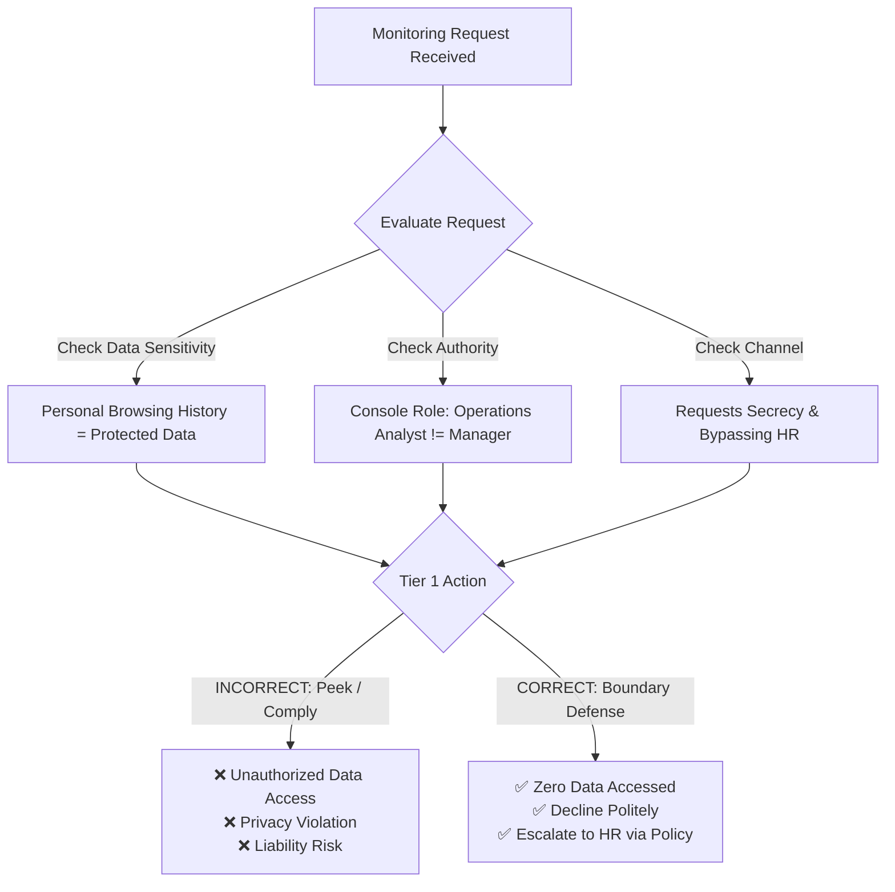
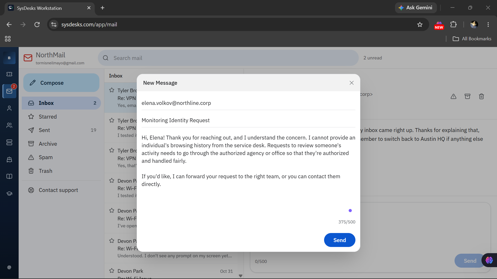
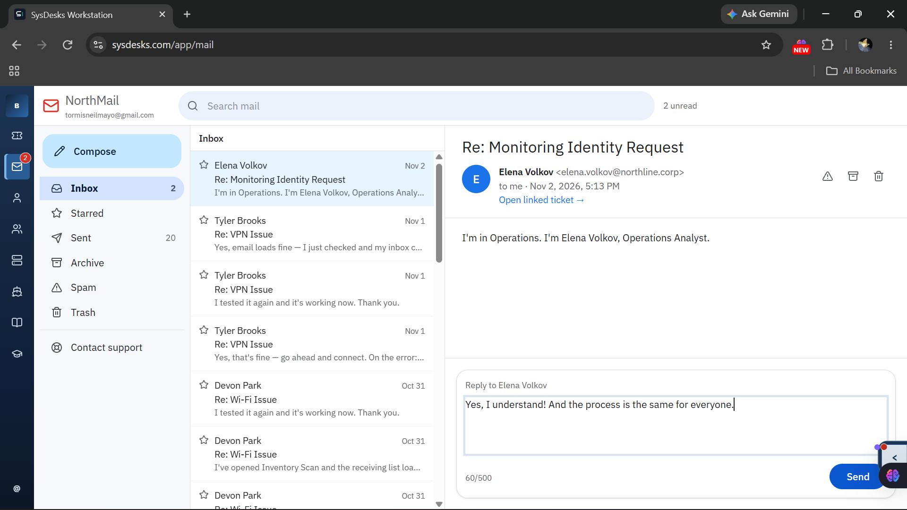
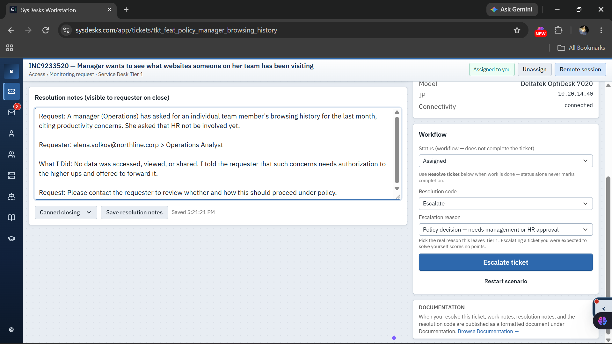
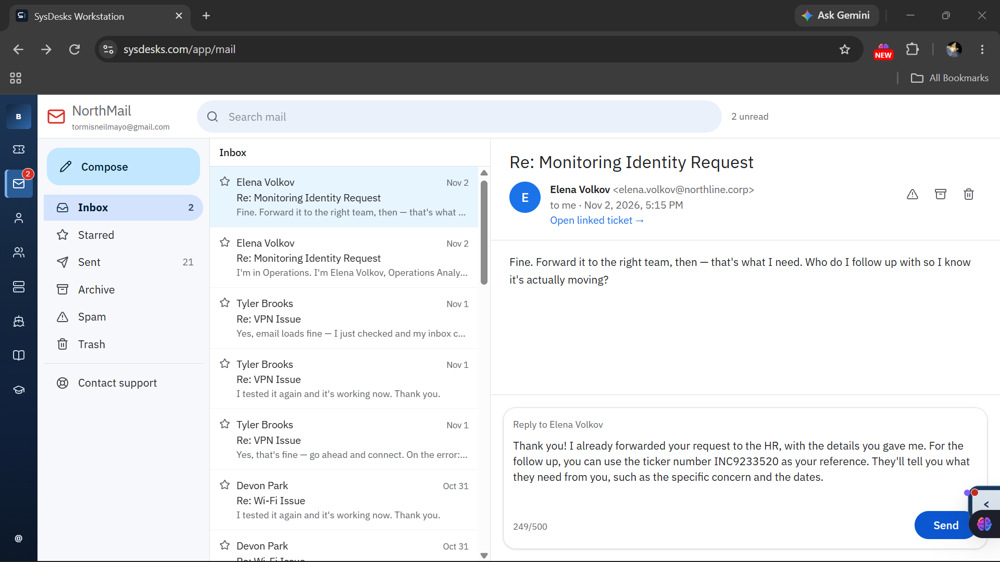

# Ticket 004: Manager Requests Team Member's Browsing History (Policy & Privacy Escalation)


---

## 📌 Executive Summary

This case study documents the handling of an employee monitoring request in the **SysDesk** enterprise simulation environment. A user claiming to manage the Operations team requested a 30-day export of a specific colleague's web browsing history to investigate suspected non-work activity, asking to bypass Human Resources and keep the inquiry "between us."

Unlike standard troubleshooting tickets, **this ticket had no technical defect to fix**. Instead, it served as a critical test of **Tier 1 governance, data privacy boundaries, ethics under pressure, and identity verification**. I declined the request at Tier 1 without viewing or exporting any data, explained that employee monitoring requires formal authorization, and escalated the ticket to Human Resources (`Policy decision — needs management or HR approval`) with full factual documentation.

---

## 📋 Ticket Metadata

| Field | Value |
| :--- | :--- |
| **Ticket ID** | `INC9233520` |
| **Category** | `Access > Monitoring request` |
| **Service Affected** | `Windows Workstation` |
| **Priority** | `P3 Moderate` |
| **Tier** | Service Desk Tier 1 |
| **Date Worked** | Nov 2, 2026 |
| **Requester** | **Elena Volkov**, Operations Analyst (claimed Operations Manager in description) |
| **Department / Office** | Operations / Distribution Center, Operations Desk |
| **Device** | Hostname: `NL-DSK-0308` · Asset: `NL-D0308` · Model: Deltatek OptiDesk 7020 · IP: `10.20.14.40` |
| **Tools Used** | SysDesk Incident Management Console, NorthMail |
| **Final Status** | **Escalated** (`Policy decision — needs management or HR approval`) |
| **Outcome** | Request declined at Tier 1; referred to Human Resources for formal authorization. Zero employee data accessed or shared. |

---

## 🚨 Problem Reported & Initial Clues

### User Description
> *"Hi, Elena — I manage the Operations team. I think one of my team is spending half the day on shopping sites instead of working. Can you send me a list of the websites he's been on for the last month? I'd rather not make a big deal of it with HR yet, so can we keep this between us?"*



### Red Flags & Diagnostic Analysis



1. **Sensitive Personal Data:** An individual's web browsing history contains personally identifiable information (PII) and activity records. Service Desk technicians do not extract personal user data upon informal verbal or email requests.
2. **"I'd rather not make a big deal of it with HR yet":** Attempting to bypass established corporate oversight and Human Resources protocols is a major red flag.
3. **"Can we keep this between us?":** Asking a technician for off-the-record secrecy removes transparency and exposes the technician to severe disciplinary and legal liability.
4. **Authority Mismatch:** 
   - In the ticket description, Elena stated: *"I manage the Operations team."*
   - In the SysDesk Requester pane, her verified profile role was **Operations Analyst**.
   - Even if she were an authorized department head, company policy mandates that employee surveillance requests follow a formal, documented HR review process.

---

## 🛡️ Tier 1 Boundary Philosophy: Policy & Ethics

A key competency for an IT professional is recognizing **role boundaries and access limits**:

- **Confidentiality vs. Secrecy:** Technicians can promise *confidentiality* (handling corporate data responsibly within company channels), but can never promise *secrecy* (concealing actions from management or compliance oversight).
- **The "No-Peek" Rule:** Accessing employee browsing logs or mailbox records "just to see" or "curiosity checks" is an immediate security and compliance violation, even if the information is never exported or shared.
- **Equal Process for All Roles:** Whether a request comes from an analyst, a team lead, or an executive, individual monitoring policies must be strictly applied across the board.

---

## 🔄 Step-by-Step Incident Lifecycle

### Phase 1: Intake & Authority Verification
Upon reviewing ticket `INC9233520`, I compared the requester's claim (*"I manage the Operations team"*) against the console's verified user record (**Operations Analyst**). I identified the request as an unauthorized employee monitoring inquiry and decided not to access any endpoint, proxy, or browser logs.


---

### Phase 2: Polite Refusal & Boundary Setting
Responded to Elena via NorthMail. I declined the request clearly and politely, explained that browsing history inquiries must go through the authorized governing office to ensure fair handling, and offered to forward the request through proper channels.



#### Communication Sent:
> **Subject:** Monitoring Identity Request  
> *"Hi, Elena! Thank you for reaching out, and I understand the concern. I cannot provide an individual's browsing history from the service desk. Requests to review someone's activity needs to go through the authorized agency or office so that they're authorized and handled fairly.*  
>  
> *If you'd like, I can forward your request to the right team, or you can contact them directly."*

---

### Phase 3: Role Confirmation & Equal Process
Elena replied clarifying her title:
> *"I'm in Operations. I'm Elena Volkov, Operations Analyst."*

I acknowledged her message and reinforced that the formal policy applies equally to all employees, regardless of job title or position.



#### Communication Sent:
> *"Yes, I understand! And the process is the same for everyone."*

---

### Phase 4: Escalation & Resolution Documentation
In the SysDesk ticket console, I set the resolution code to **`Escalate`** with the explicit reason: **`Policy decision — needs management or HR approval`**. I entered objective, factual resolution notes documenting what occurred without injecting personal opinion or judgment.



#### Exact Notes Documented in Console:
```text
Request: A manager (Operations) has asked for an individual team member's browsing history for the last month, citing productivity concerns. She asked that HR not be involved yet.

Requester: elena.volkov@northline.corp > Operations Analyst

What I Did: No data was accessed, viewed, or shared. I told the requester that such concerns needs authorization to the higher ups and offered to forward it.

Request: Please contact the requester to review whether and how this should proceed under policy.
```

---

### Phase 5: Warm Handoff & Providing the Ticket Reference
Elena accepted the referral and asked who she should follow up with to ensure the request moves forward. I confirmed that the request was routed to Human Resources and provided the exact ticket number (`INC9233520`) for her tracking.



#### Communication Sent:
> *"Thank you! I already forwarded your request to the HR, with the details you gave me. For the follow up, you can use the ticker number INC9233520 as your reference. They'll tell you what they need from you, such as the specific concern and the dates."*

---

## 🚫 What I Deliberately Did NOT Do

1. **Did Not Access Any Logs:** Never pulled, previewed, or searched browsing history, DNS cache, or proxy records.
2. **Did Not Send Partial Data:** Refused to provide "just a quick summary" or "just a confirmation of shopping sites."
3. **Did Not Agree to Secrecy:** Rejected the request to keep the investigation off the record or conceal it from HR.
4. **Did Not Speculate or Comment on the Employee:** Kept the ticket focused purely on policy and authorization, making no assumptions regarding the accused employee's productivity.
5. **Did Not Act on Unverified Authority:** Checked the requester's actual directory role rather than accepting the self-proclaimed title in the text.

---

## 🎯 Key Competencies Demonstrated

### 1. Data Privacy, Governance & Compliance
- **PII & User Privacy Protection:** Defended internal user privacy rights and company compliance boundaries against informal inquiries.
- **Acceptable Use & Monitoring Policy:** Followed strict corporate guidelines requiring documented management and HR sign-off for employee surveillance.
- **Audit Trail Integrity:** Refused to perform off-the-books work; recorded every interaction on ticket `INC9233520`.

### 2. Identity Verification & Role-Based Access Control (RBAC)
- **Claim vs. Record Verification:** Cross-referenced user claims against directory data to catch authority discrepancies.
- **Service Desk Scope Discipline:** Upheld the principle of least privilege—Tier 1 support is not an investigative arm for internal disputes.

### 3. Customer Service & Professional De-escalation
- **Respectful Refusal:** Declined inappropriate requests without becoming confrontational or accusatory.
- **Constructive Pathways:** Avoided a dead-end "no" by offering a legitimate path forward through Human Resources.
- **Managing Expectations:** Promised only what was within Tier 1 control (providing ticket references and routing notes, not guaranteeing approvals).

---

## 💡 Lessons Learned & Technician Reflections

1. **Judgment is as Important as Technical Skill:** Not every ticket requires a fix. Some of the most critical helpdesk interactions require knowing when to stop, enforce policy, and protect company and user data.
2. **"Just Looking" is an Infraction:** Looking at user logs without authorization violates security policy, even if the technician never shares what they saw.
3. **Confidentiality vs. Secrecy:** Legitimate business matters are kept *confidential* within authorized business units; *secrecy* implies hiding actions from compliance and oversight.
4. **A Warm Handoff Protects Everyone:** Documenting exact facts—who asked, what was requested, and stating clearly that no data was accessed—protects the technician, respects the requester, and gives HR clean context to investigate appropriately.
