# Ticket 004: VPN Connected but Internal File Share Unreachable

-2ea44f?style=for-the-badge)


---

## 📌 Summary

A remote user's VPN showed **connected**, and his email and the HR portal worked, but the project file share `\\NL-FS-02\Projects` **timed out** every time. Over a remote session I found that the VPN was connected to the **Austin HQ gateway**, which doesn't route to the network where the file server lives (`10.30.50.0/24`). I switched the VPN to the **Distribution Center gateway**, the user confirmed the share opened and his email still worked, and I closed the ticket.

One command-line test still failed after the fix, even though the share worked. I document that below instead of hiding it.

---

## 📋 Ticket Details

| Field | Value |
| :--- | :--- |
| **Ticket** | `INC8522084` |
| **Category** | `Network > VPN` |
| **Service** | Northline VPN |
| **Priority** | `P2 High` |
| **Tier** | Service Desk Tier 1 |
| **Date** | Nov 1, 2026 |
| **Requester** | **Tyler Brooks**, Facilities Coordinator (Facilities, Austin HQ), working from home |
| **Device** | Hostname `NL-LPT-0410` · Asset `NL-L0410` · HelixPrint ProNote 450 · IP `10.20.14.40` |
| **Tools used** | Ticket console, NorthMail, remote session, Northline Secure Access (VPN client), command line (`ipconfig`, `nslookup`, `Test-NetConnection`¹, `tracert`) |
| **Status** | Resolved. Resolution code: **Solved (Permanently)** |

<sub>¹ `Test-NetConnection` is a PowerShell cmdlet. The SysDesk simulation runs it inside its Command Prompt window. On a real Windows machine you would run it in PowerShell.</sub>

---

## 🚨 Problem Reported

> *"Hi, this is Tyler. I'm working from home today and I've been added to a project that keeps its files on \\\\NL-FS-02\Projects. The VPN says it's connected — green tick, the whole thing — and my email and the HR portal both work fine, but that share just times out every time I try to open it. I've disconnected and reconnected it twice and restarted the laptop. Colleague in the warehouse says it opens fine for her."*

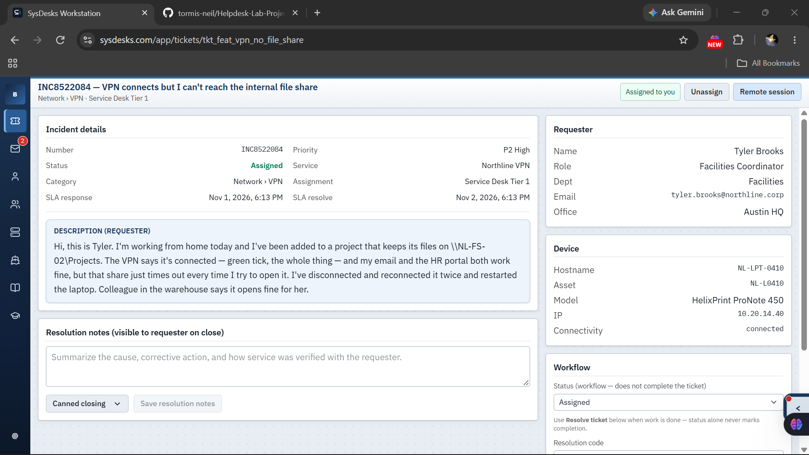

---

## 🔍 Clues

- **A timeout, not "access denied":** this points to a network path problem, not permissions.
- **A colleague at the warehouse could open it:** the server and share were up, so the problem was on Tyler's path to them.
- **Email and the HR portal worked:** this doesn't prove the VPN reaches everything, because those services can be hosted on a different network or in the cloud.
- **The share was addressed by hostname:** DNS needed checking.
- **He was newly added to the project:** access and groups could matter, but the timeout made that less likely.

## 🧪 Hypotheses

| # | Hypothesis | Result |
| :---: | :--- | :--- |
| 1 | DNS can't resolve the server name over the VPN | **Ruled out:** `nslookup` returned `10.30.50.40` |
| 2 | No route to the file server's network | **Confirmed:** the connected gateway didn't list `10.30.50.0/24` |
| 3 | VPN access policy or group doesn't allow it | **Not needed:** the share opened after the gateway switch |
| 4 | Firewall blocking SMB (port 445) | **Considered, then dropped** (see [What didn't add up](#-what-didnt-add-up)) |
| 5 | Share permissions | **Unlikely** given the timeout, and not needed |

### The key check: is the server's IP on a routed network?

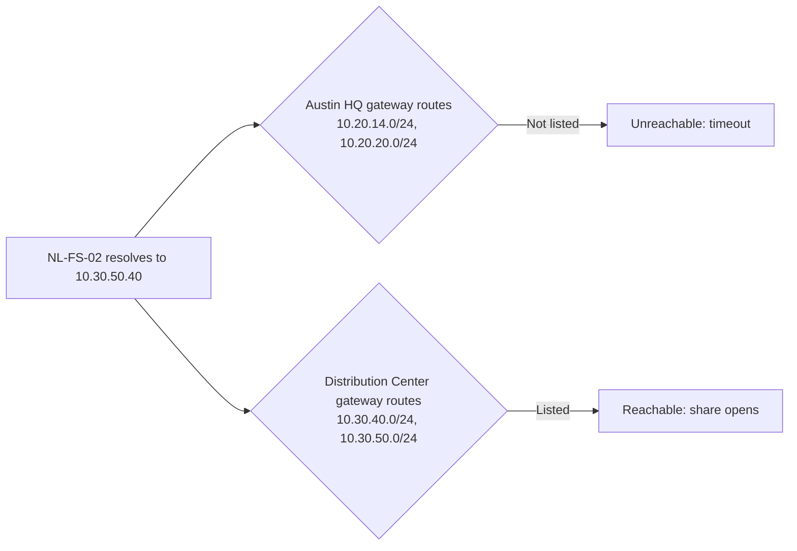

---

## 🛠️ What I Did

### 1. Asked for the missing facts
Before touching anything, I listed the clues and wrote my hypotheses. Then I thanked Tyler and asked him two questions: what the error said exactly, and whether other internal resources worked over the VPN. I also asked his permission to connect remotely.

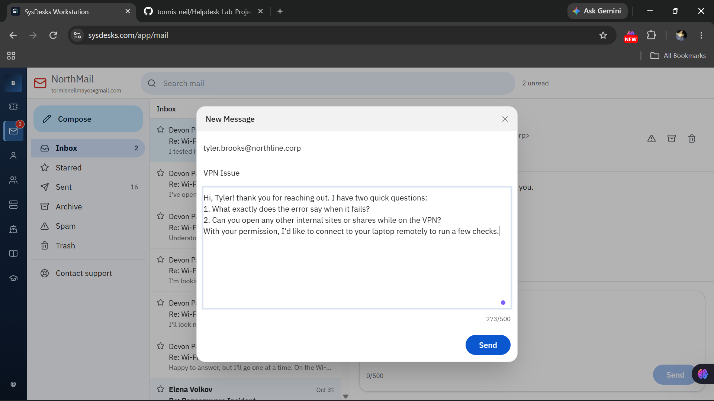

He said the error only says the share "can't be reached," that email and the HR portal load fine, and he gave permission to connect.


### 2. Checked the VPN client
The tunnel was up to **Austin HQ (Austin, TX)**. The client listed the networks routed over this tunnel: `10.20.14.0/24` and `10.20.20.0/24`. A note in the client said anything on a network not listed there isn't reachable through this gateway.

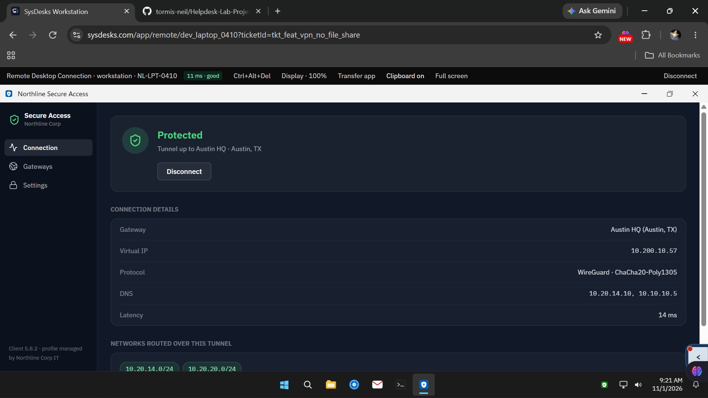

### 3. Checked DNS
- `ipconfig /all`: the DNS server was the company server `10.20.14.10`, so the DNS configuration looked right.
- `nslookup NL-FS-02`: it resolved to **`10.30.50.40`**, which is **outside both routed networks**.

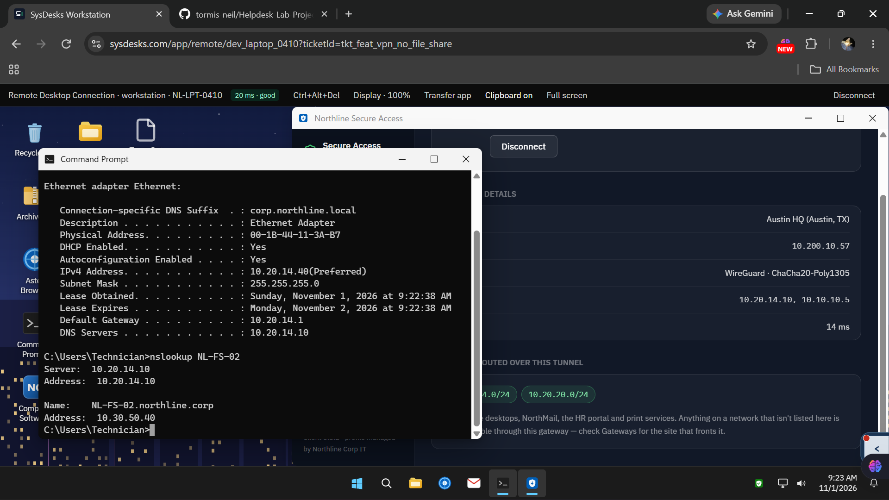

### 4. Tested the path and found the right gateway
- `Test-NetConnection NL-FS-02 -Port 445` returned `TcpTestSucceeded : False`.
- The client's **Gateways** tab showed that the **Distribution Center (San Marcos, TX)** gateway serves "warehouse systems, the inventory database and the project file servers," and routes `10.30.40.0/24` and **`10.30.50.0/24`**.

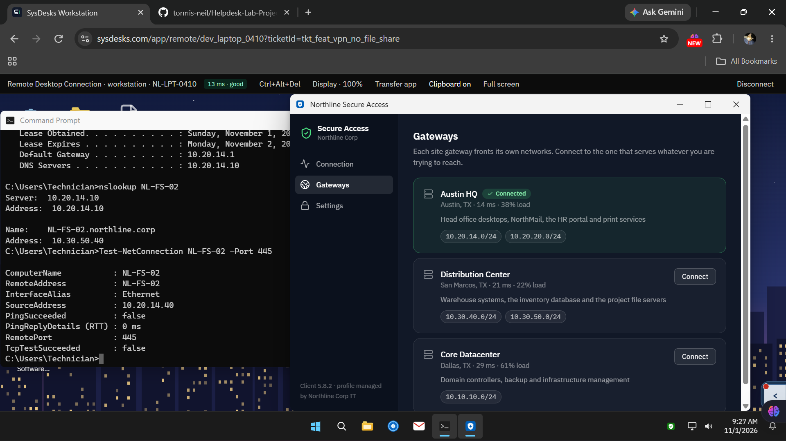

### 5. Switched the gateway
I switched the VPN to the Distribution Center gateway during the remote session Tyler had already approved, and explained the change to him afterward.

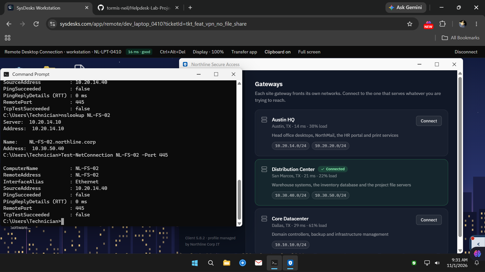

### 6. Re-ran the checks
The tunnel was now up to Distribution Center, and the routed networks included `10.30.50.0/24`. `tracert -d 10.30.50.40` reached the server in **3 hops**.

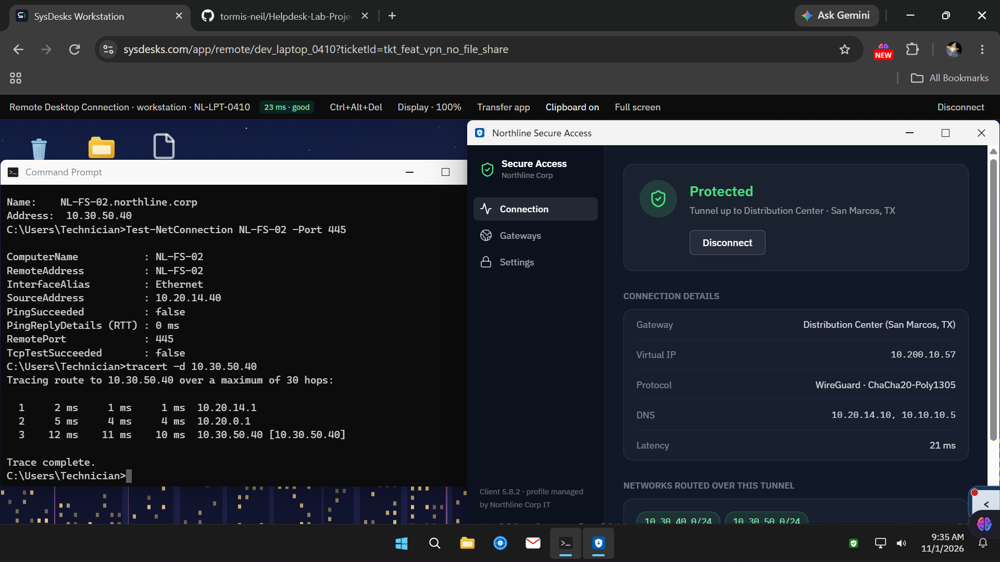

### 7. Asked the user for the real test
The port test was still reporting a failure (see below), so I asked Tyler to open the share himself and tell me exactly what it said.

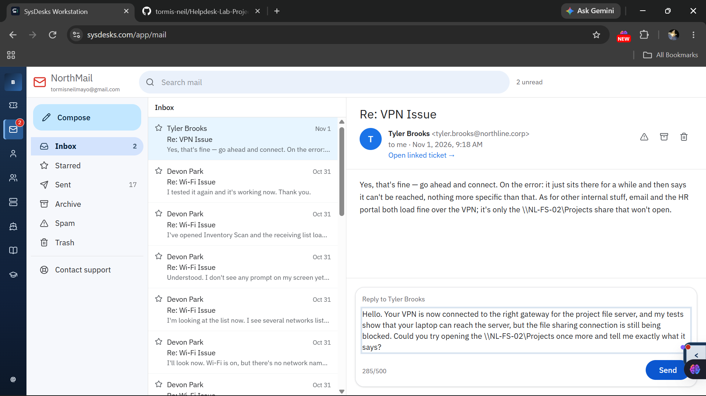

### 8. Confirmed the fix and checked for side effects
Tyler said the share works now. I explained the cause and told him to keep using the Distribution Center gateway for project files, and to switch back to Austin HQ in the VPN app's Gateways tab if email or the HR portal stop loading.

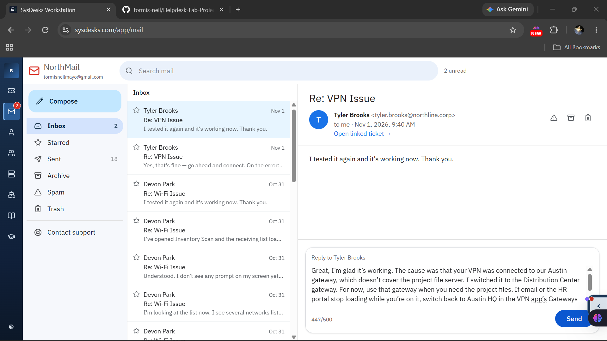

He confirmed his email still loads on the new gateway.

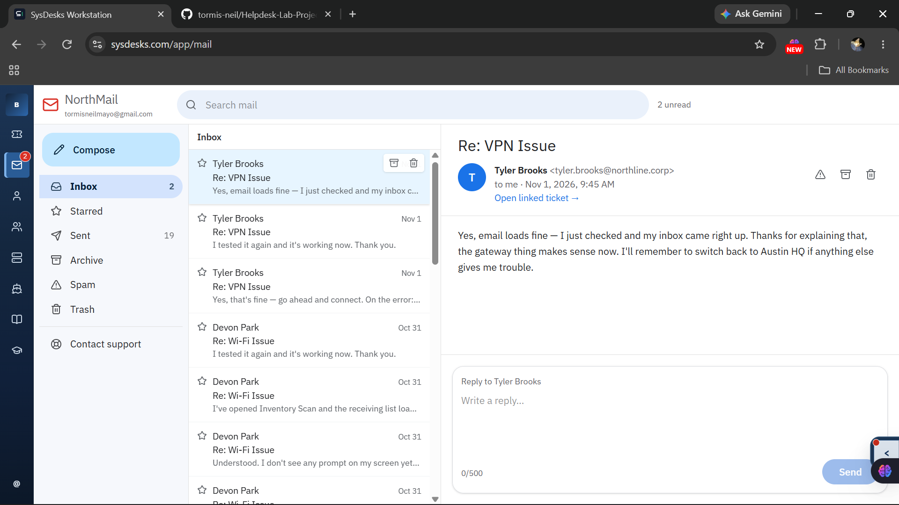

### 9. Documented and closed

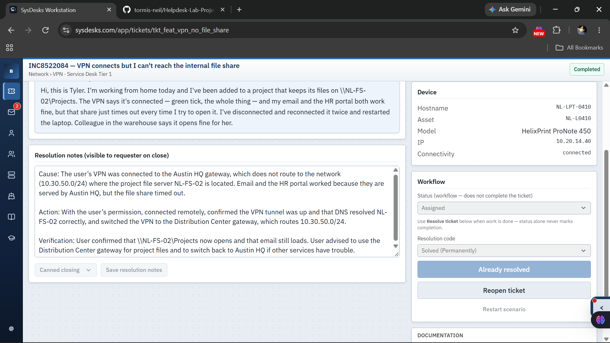

```text
Cause: The user's VPN was connected to the Austin HQ gateway, which does not route to the
network (10.30.50.0/24) where the project file server NL-FS-02 is located. Email and the HR
portal worked because they are served by Austin HQ, but the file share timed out.

Action: With the user's permission, connected remotely, confirmed the VPN tunnel was up and
that DNS resolved NL-FS-02 correctly, and switched the VPN to the Distribution Center gateway,
which routes 10.30.50.0/24.

Verification: User confirmed that \\NL-FS-02\Projects now opens and that email still loads.
User advised to use the Distribution Center gateway for project files and to switch back to
Austin HQ if other services have trouble.
```

---

## ✅ Root Cause, Resolution, Verification

| | |
| :--- | :--- |
| **Root cause** | The VPN was connected to the Austin HQ gateway, which doesn't cover the network where the file server lives. Each VPN gateway only reaches its own networks. |
| **Resolution** | Switched the VPN to the Distribution Center gateway. Advised the user to switch back to Austin HQ if email or the HR portal stop loading. |
| **Verification** | The user confirmed the share opens and that email still works. The routed networks now include `10.30.50.0/24`. |

---

## ❓ What Didn't Add Up

- After the switch, the `Test-NetConnection` port 445 test **still reported failure**, even though the share worked afterward.
- The first hops in the `tracert` showed `10.20.x` addresses, which looked like the old path.
- At first I suspected a firewall or access rule, and I told the user the file-sharing connection was "still being blocked." I over-read one failed test, and the user's real result contradicted it.
- My best guess is timing: the tunnel needed a moment to settle, so my tests ran too early. **I couldn't confirm that, and I didn't re-run the port test afterward**, so this stays an open question.

---

## 💬 Plain-Language Explanation for the User

> "Your VPN connected to our Austin office, which only reaches some company systems, like email and the HR portal. The project files are stored at our Distribution Center, which has its own VPN gateway. I moved your VPN to that gateway, and now the files open."

---

## 🎯 Skills Shown

- **Network troubleshooting:** compared the server's IP against each gateway's routed networks. Used `ipconfig`, `nslookup`, `Test-NetConnection`, and `tracert` to check DNS and then the network path, in that order.
- **Hypothesis-driven work:** wrote hypotheses before touching anything and ruled them in or out with evidence.
- **Reading symptoms:** treated a timeout as a path problem, not a permissions one, and didn't treat a colleague who sits on the server's network as proof that the VPN path works.
- **Verification:** treated the user's real test as the final word and checked for side effects (email) after the change.
- **Honest documentation:** recorded the test that didn't fit instead of leaving it out.

---

## 💡 What I Learned

1. "VPN connected" doesn't mean "everything reachable." Each gateway covers specific networks.
2. Compare the server's IP with the routed networks list.
3. A timeout points to the network path. "Access denied" points to permissions.
4. A colleague who is physically on the server's network can't prove that the VPN path works.
5. A command result can mislead, especially right after a change. The user's real result is the final test.
6. Check for side effects after a fix, such as whether other services still work.
7. If you don't know why something happened, say so.
