# Ticket 005: Machine Hasn't Updated in Months, Failing Compliance Scan (VPN Kill Switch Isolation)

-2ea44f?style=for-the-badge)


---

## 📌 Executive Summary

This case study documents the troubleshooting and resolution of an enterprise endpoint compliance failure in the **SysDesk** simulation environment. A corporate laptop assigned to an HR Generalist was flagged by the IT Security team during a monthly compliance audit for missing critical OS patches since **May 2, 2026** (over 6 months out of compliance). When the user attempted to run Windows Update manually, the process stalled with error **`0x800f0922`**, blocking all subsequent cumulative and Defender security updates.

Through structured remote troubleshooting, I evaluated common update failure modes (disk exhaustion, service crashes, cache corruption) and identified the actual root cause: **the laptop's corporate VPN client (Northline Secure Access) was disconnected while its security "Kill switch" was active**, cutting off network routing to corporate update infrastructure. Reconnecting the VPN tunnel to the Austin HQ gateway instantly cleared the error, synced the update catalog, and brought the device back into 100% security compliance.

---

## 📋 Ticket Metadata

| Field | Value |
| :--- | :--- |
| **Ticket ID** | `INC9207926` |
| **Category** | `Software > Windows Update` |
| **Service Affected** | `Windows Workstation` |
| **Priority** | `P3 Moderate` |
| **SLA Response** | Nov 5, 2026, 6:13 PM \| **SLA Resolve:** Nov 6, 2026, 6:13 PM |
| **Tier** | Service Desk Tier 1 |
| **Date Worked** | Nov 13, 2026 |
| **Requester** | **Priya Nair**, HR Generalist (Human Resources) |
| **Department / Office** | Human Resources / Building C, Room 204 |
| **Device** | Hostname: `NL-LPT-0512` · Asset: `NL-L0512` · Model: HelixPrint EliteNote 840 · IP: `10.20.14.40` |
| **Tools Used** | SysDesk Incident Console, Remote Desktop Session, Windows Settings, Northline Secure Access (VPN), NorthMail |
| **Final Status** | **Solved (Permanently)** |

---

## 🚨 Problem Reported & Initial Clues

### User Description
> *"Hi, this is Priya again. Security flagged my laptop as out of date on this month's compliance scan. I've clicked Check for updates a few times and it just sits there saying something failed. Can you get it current before they chase me again?"*

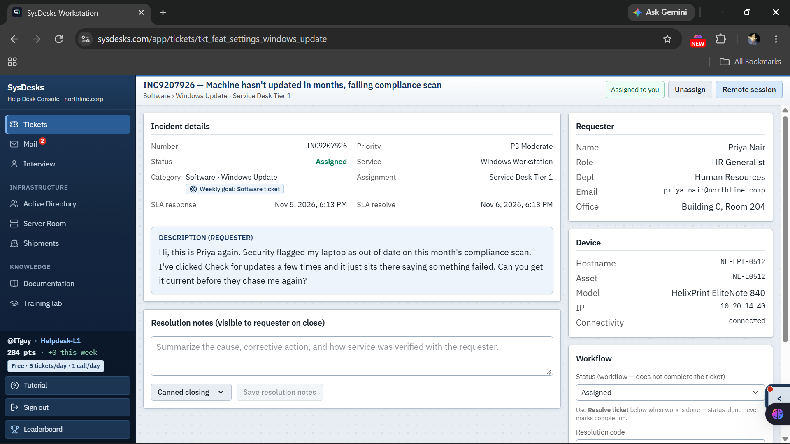

### Key Clues from Initial Triage
1. **6-Month Update Gap:** Windows Update revealed `Last successful install: May 2, 2026`. The machine had not received patches for half a year.
2. **Error Code `0x800f0922`:** The 2026-05 Cumulative Update (`KB5031455`) had failed with `0x800f0922`, creating a bottleneck that left the subsequent 2026-08 Cumulative Update, Defender definitions, and Servicing Stack Update in a perpetual **"Waiting"** state.
3. **User Anxiety:** Requester felt pressured by impending Security escalation, requiring swift resolution, clear communication, and non-disruptive remote assistance.

---

## 🧪 Differential Diagnosis (Hypotheses Evaluated)

| Hypothesis | Likelihood | Investigation / Test | Result |
| :--- | :---: | :--- | :---: |
| **1. Disk Space Exhaustion** | High | Checked `Settings > System > Storage`. C: had **205 GB free of 476 GB**. Recycle Bin was empty. | **RULED OUT** |
| **2. Corrupted Update Cache (`SoftwareDistribution`)** | Medium | Updates failed before staging/download completed; services were responsive. | **RULED OUT** |
| **3. Update Service Disabled (`wuauserv` / BITS)** | Low | Windows Update UI was actively running scans and attempting installs. | **RULED OUT** |
| **4. Network Isolation via VPN Kill Switch** | **High** | Inspected `Northline Secure Access`. Status was **`Not connected`** with **`Kill switch: On`**. | **CONFIRMED** |

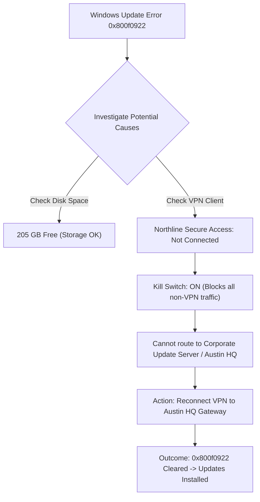

---

## 🛠️ Step-by-Step Incident Lifecycle

### Phase 1: Intake & Remote Consent
Before accessing the user's laptop, I messaged Priya via NorthMail acknowledging her urgency regarding the Security compliance scan and requesting permission to start a remote support session.

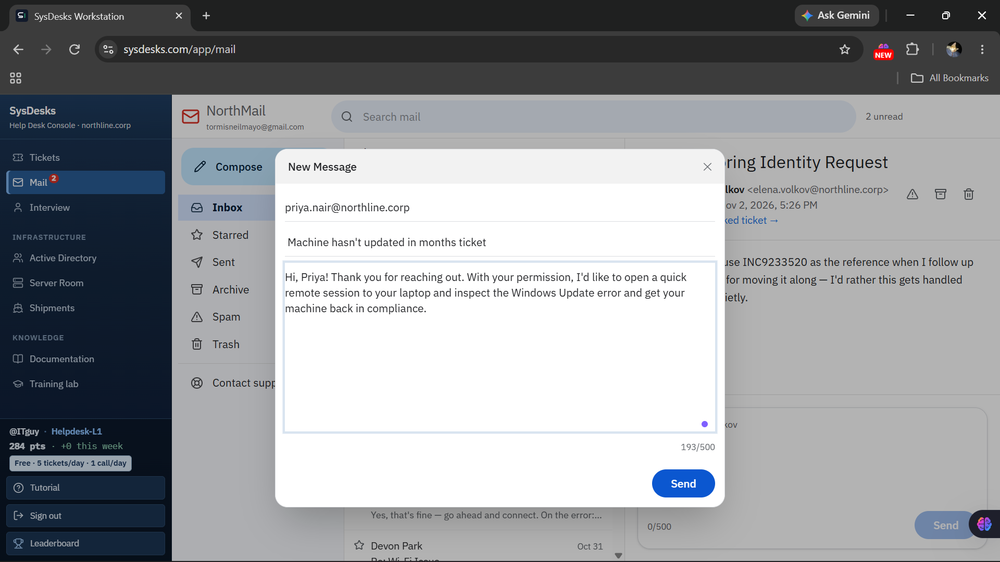

#### Communication Sent:
> **Subject:** Machine hasn't updated in months ticket  
> *"Hi, Priya! Thank you for reaching out. With your permission, I'd like to open a quick remote session to your laptop and inspect the Windows Update error and get your machine back in compliance."*

---

### Phase 2: User Permission Granted
Priya responded promptly, confirming she was logged in at her desk and granting permission to connect.

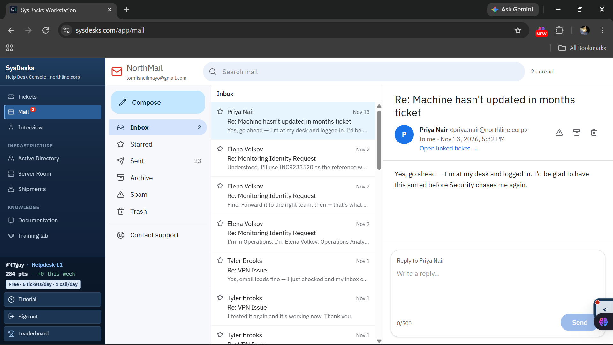

#### User Reply:
> *"Yes, go ahead — I'm at my desk and logged in. I'd be glad to have this sorted before Security chases me again."*

---

### Phase 3: Inspecting Windows Update (`0x800f0922`)
Connected via Remote Desktop to `NL-LPT-0512`. Opened **Settings > Windows Update**:
- **Banner:** `Updates failed to install — Some updates couldn't be installed. Windows will keep trying, and nothing queued behind them installs in the meantime.`
- **Blocked Update:** `2026-05 Cumulative Update for Windows 11 Version 23H2 (KB5031455)` displaying **`Install error - 0x800f0922`**.
- **Queued Updates:** 2026-08 Cumulative Update, Defender definitions, and Servicing Stack all stuck in **"Waiting"**.

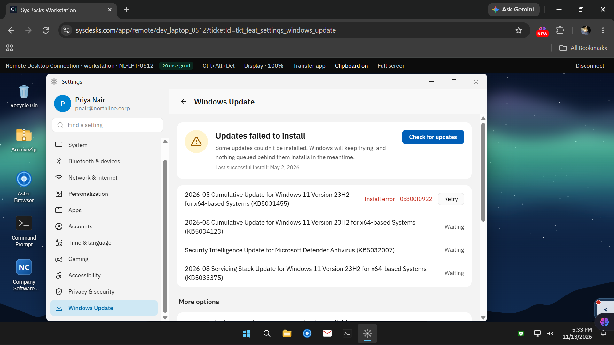

---

### Phase 4: Disk Space & Storage Verification
Because `0x800f0922` frequently stems from insufficient system partition space, I navigated to **Settings > System > Storage**:
- **Local Disk (C:):** **`205 GB free of 476 GB`**.
- Storage utilization was completely healthy, definitively ruling out disk exhaustion as the cause.

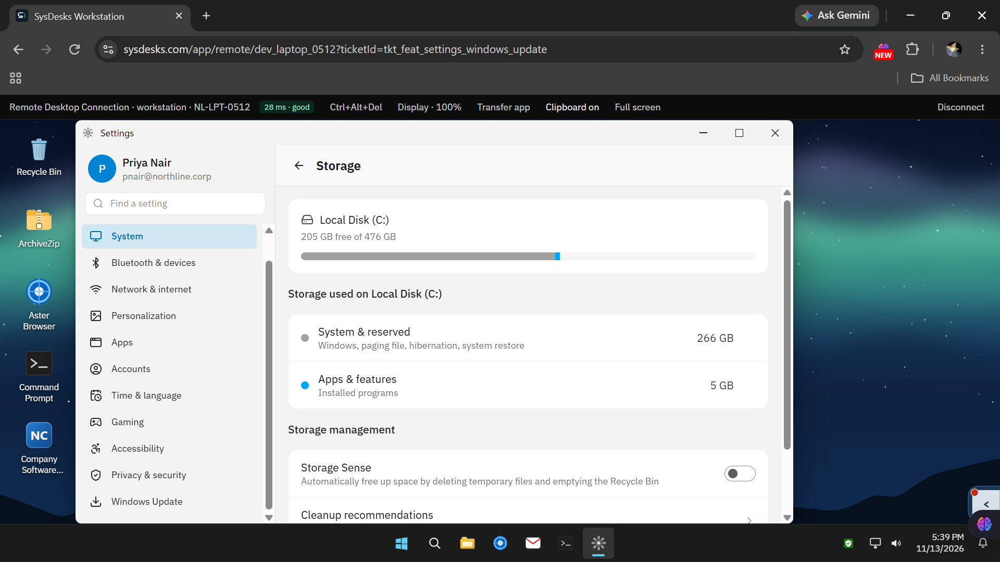

---

### Phase 5: Root Cause Discovery — VPN Kill Switch
Investigating network connectivity, I opened **Northline Secure Access** from the system tray / desktop:
- **Status:** **`Not connected`** (*"Your traffic is not going through the company network"*)
- **Kill switch:** **`On`**
- **Selected Gateway:** **Austin HQ (Austin, TX)**

A VPN **Kill Switch** prevents unencrypted traffic by severing internet/network routing whenever the VPN tunnel drops. Because Northline's patch management policies require connection to corporate endpoints (`10.20.14.0/24`), the active Kill Switch prevented Windows Update from reaching the catalog, triggering error `0x800f0922`.

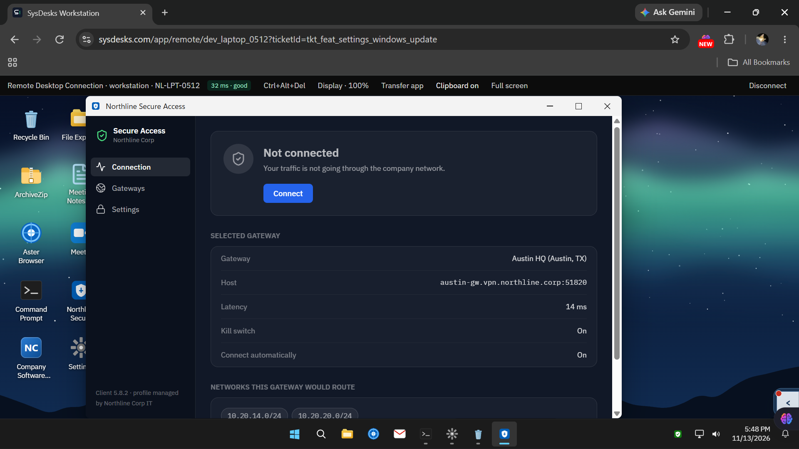

---

### Phase 6: Restoring the VPN Tunnel
Clicked the blue **`Connect`** button in Northline Secure Access to establish the tunnel to the Austin HQ gateway.
- **Connection Status:** Changed to **`Protected`** (Green shield, 14 ms latency, virtual IP `10.200.10.44`).

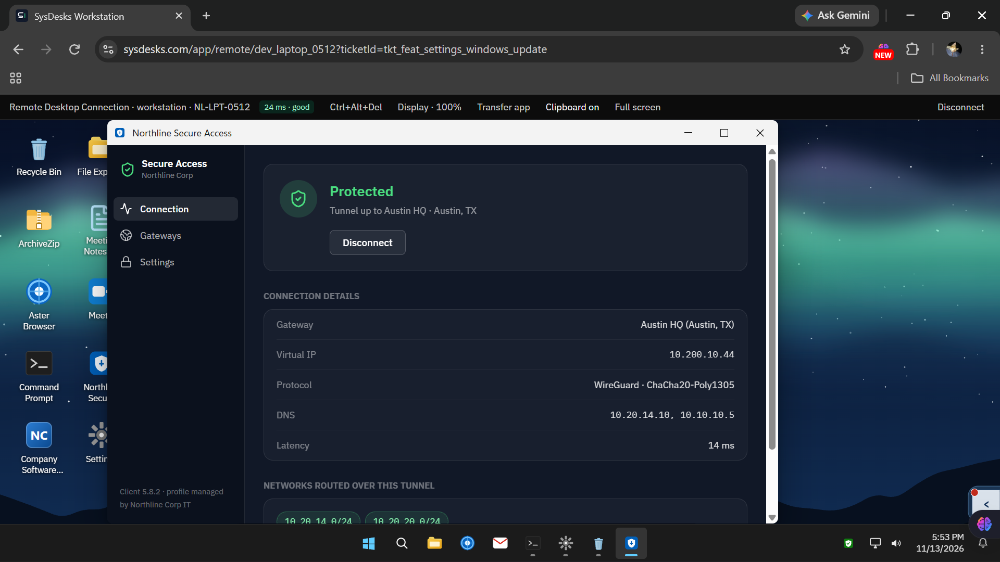

---

### Phase 7: Windows Update Rescan & Download Staging
Returned to Windows Update and clicked **Check for updates**:
- Error `0x800f0922` immediately cleared.
- Status updated to **`Updates available`**.
- All pending updates (`2026-08 Cumulative Update KB5034123`, `Defender Antivirus KB5032007`, `Servicing Stack KB5033375`, and `Intel System Driver`) transitioned to **`Ready to install`**.
- Clicked **`Install all`** to initiate installation.

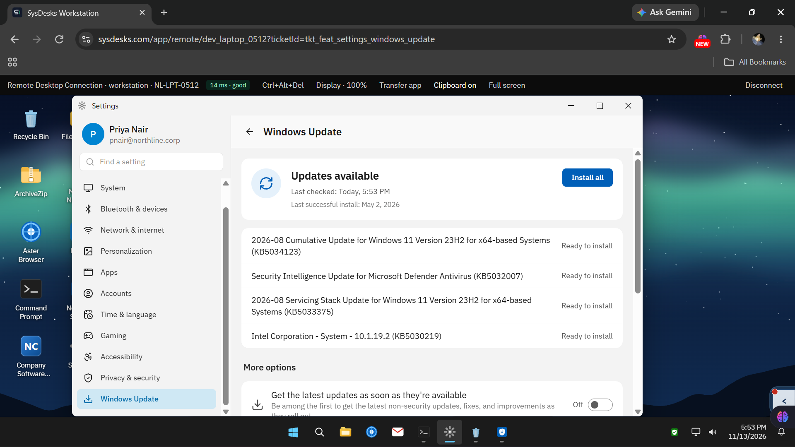

---

### Phase 8: Verification — 100% Patch Compliance
Monitored the installation progress through completion:
- Status transitioned to a green checkmark: **`You're up to date`** (`Last checked: Today, 5:53 PM` · `Last successful install: November 13, 2026`).
- System compliance was completely restored.

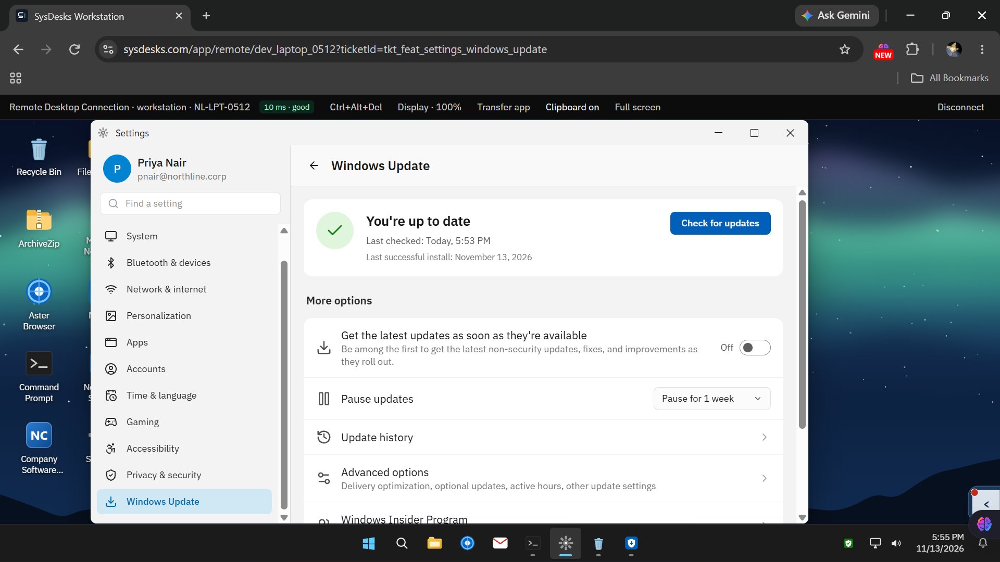

---

### Phase 9: End-User Communication & Best Practice Guidance
Messaged Priya via NorthMail explaining the root cause in accessible terms and providing proactive advice to prevent recurrence.

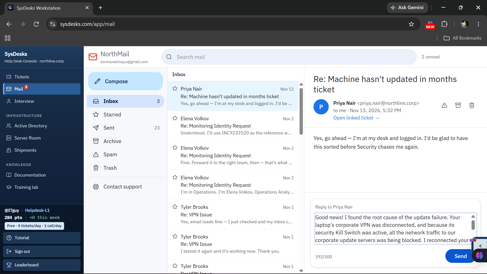

#### Communication Sent:
> *"Good news! I found the root cause of the update failure. Your laptop's corporate VPN was disconnected, and because its security Kill Switch was active, all the network traffic to our corporate update servers was being blocked. I reconnected your laptop to the Austin HQ gateway and re-checked for updates. The error has cleared, and your laptop is now fully up to date and compliant with Security standards.*  
>  
> *Please ensure your VPN remains connected while working remotely so future compliance updates install automatically."*

---

### Phase 10: Ticket Documentation & Formal Closure
Updated the ticket resolution notes in the SysDesk console, set the resolution code to **`Solved (Permanently)`**, and closed ticket `INC9207926`.

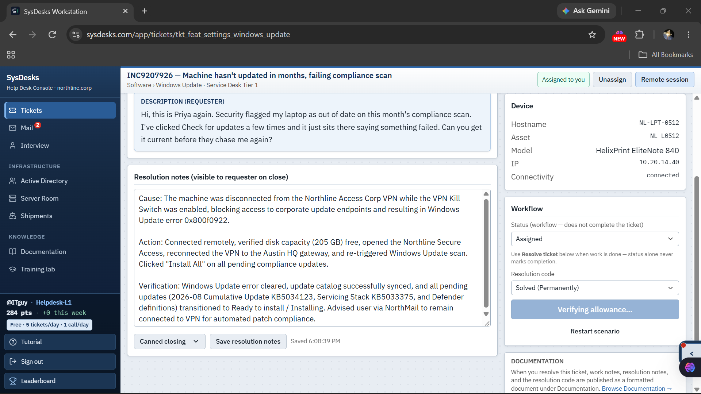

#### Exact Notes Documented in Console:
```text
Cause: The machine was disconnected from the Northline Access Corp VPN while the VPN Kill Switch was enabled, blocking access to corporate update endpoints and resulting in Windows Update error 0x800f0922.

Action: Connected remotely, verified disk capacity (205 GB free), opened the Northline Secure Access, reconnected the VPN to the Austin HQ gateway, and re-triggered Windows Update scan. Clicked "Install All" on all pending compliance updates.

Verification: Windows Update error cleared, update catalog successfully synced, and all pending updates (2026-08 Cumulative Update KB5034123, Servicing Stack KB5033375, and Defender definitions) transitioned to Ready to install / Installing. Advised user via NorthMail to remain connected to VPN for automated patch compliance.
```

---

## 🎯 Key Competencies Demonstrated

### 1. Endpoint Patch Management & Windows Troubleshooting
- **Error Code Interpretation:** Correctly assessed that `0x800f0922` indicates endpoint network reachability failure during package staging.
- **Queue Dependency Resolution:** Understood that a single blocked cumulative update stalls all subsequent security definitions and servicing stack updates.
- **Patch Pipeline Verification:** Followed through installation until the operating system confirmed patch installation with the green *"You're up to date"* state.

### 2. Network & Security Architecture Awareness
- **VPN Kill Switch Dynamics:** Recognized that an active Kill Switch on a disconnected client enforces total network isolation, preventing local background services from reaching update catalogs.
- **Enterprise Gateway Scoping:** Ensured the client connected to the appropriate gateway (**Austin HQ**) responsible for routing corporate update and internal infrastructure traffic.

### 3. Customer Service & Compliance De-escalation
- **Alleviating User Stress:** Reassured an end-user anxious about security audit penalties, handling the request with urgency.
- **Remote Support Etiquette:** Secured formal consent before initiating remote control.
- **Proactive User Education:** Explained the relationship between VPN connectivity and patch compliance to prevent repeat tickets.

---

## 💡 Lessons Learned & Technician Reflections

1. **Rule Out the Obvious Before Deep-Diving:** When Windows Update fails, technicians often prematurely run invasive cleanup tools (like wiping `SoftwareDistribution` or resetting CBS registries). Checking storage and network connectivity first solves the problem much faster.
2. **Security Controls Can Impede IT Operations:** VPN Kill Switches are great for data leak prevention, but if users work disconnected, endpoints fall behind on patch cycles. IT support must look for security software interactions during network failures.
3. **Finish the Job with Full Verification:** Leaving a machine at "Downloading 45%" is incomplete support. Verifying that all updates install and seeing the green "Up to date" checkmark guarantees the user won't get flagged again.
